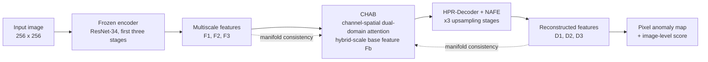
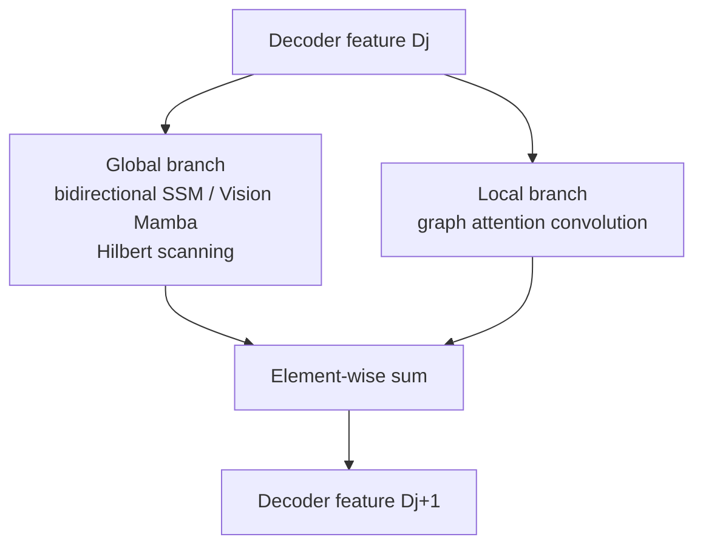

# MCDD

**Official code for _Manifold-Constrained Dynamic Decoupling Learning for Unsupervised Multiclass Anomaly Detection_.**


MCDD is a unified unsupervised framework for multiclass industrial anomaly detection and localization. A single model is trained on the normal samples of all categories and evaluated on MVTec AD and VisA without per-category retraining.

---

## 📰 News

- **2025.09** — Paper published in *IEEE Transactions on Instrumentation and Measurement*, vol. 74, art. 2546611.
- **Code release in progress** — training/testing scripts, configuration files, and pretrained weights will be uploaded in this repository. The sections below describe the intended interface and are marked `TBD` where the code is not yet available.

---

## ✨ Overview

Unsupervised multiclass anomaly detection has to reconcile two conflicting requirements: a unified model must generalize across categories, yet it must also localize fine-grained defects precisely. Fixed encoders preserve generalization but allow anomalous features to leak into the reconstruction; adaptive encoders improve fitting but overfit the training categories and lose cross-category transferability. Feature fusion in existing decoders further relies on simple concatenation or addition, which cannot dynamically calibrate cross-hierarchy information.

MCDD resolves this by imposing dual constraints on the normal feature manifold. First, multiscale features from a frozen encoder are refined rather than retrained, so the representation space remains category-agnostic. Second, reconstruction is performed by learnable decoders that are explicitly regularized against overfitting to normal-only training data. The manifold consistency objective keeps projected features close to the frozen encoder features at all three hierarchical levels, so that normal samples stay compact on the manifold while anomalous deviations are pushed away.

Three modules implement this design: the Cross-Hierarchy Attentive Bottleneck (CHAB) builds a hybrid-scale base feature with channel–spatial dual-domain attention gating; Noise-Augmented Feature Expansion (NAFE) injects attention-gated learnable Gaussian noise during decoder upsampling; and the Hybrid Perception Reasoning Decoder (HPR-Decoder) combines Visual Mamba long-range dependency modeling with graph attention convolution for local correlation reasoning. The resulting single model reaches competitive multiclass performance with 24.7M parameters and 7.4G FLOPs.

---

## 🏗️ Architecture



Inside the HPR-Decoder, each stage runs two parallel branches whose outputs are summed:



### Key components

| Module | Design | Role |
| --- | --- | --- |
| **CHAB** | Shallow and mid-level features fused by EMA blocks, deep feature added, then refined by global context pooling and cross-channel interaction | Constructs a compact hybrid-scale normal base feature instead of concatenating hierarchy levels |
| **NAFE** | Pixel-shuffle expansion, spatial attention map from average/max pooling, gated learnable Gaussian noise (`σ = 0.2` in the reported configuration) | Prevents decoder overfitting to normal-only data and suppresses anomalous features passed from the encoder |
| **HPR-Decoder** | Vision Mamba global branch with Hilbert scanning + graph attention convolution local branch | Captures long-range dependencies and local texture correlations simultaneously for pixelwise localization |

The manifold consistency loss is applied at three hierarchical levels:

```text
L_manifold(I; θ) = Σ_{i=1..3} || Proj_θ(F_i) - F_i ||²
```

---

## 📊 Results

Reported in the IEEE TIM paper under multiclass training: one model per dataset, trained only on normal images. The full seven-metric tables and per-category results are in the paper.

| Dataset | Image AU-ROC | Image AP | Image F1 max | Pixel AU-ROC | mAD-5 | mAD-7 |
| --- | :---: | :---: | :---: | :---: | :---: | :---: |
| MVTec AD | 98.5 | 99.5 | 97.6 | 97.8 | 89.3 | 86.3 |
| VisA | 94.7 | 95.2 | — | — | 83.7 | 79.0 |

**Efficiency.** 24.7M parameters and 7.4G FLOPs, comparable in size to UniAD (24.5M) while outperforming DiAD and MambaAD on the composite mAD-7 metric.

**Key findings from the ablation study**

- Replacing CHAB with a plain convolutional bottleneck degrades every metric, including a 0.2 drop in image-level AU-ROC.
- A serialized graph-reasoning variant loses 0.7 on both mAD-5 and mAD-7, confirming the need for hierarchical graph interaction across scales.
- Noise intensity is decisive: `σ = 0.2` gives the best trade-off, while excessive noise suppresses useful normal structure.
- Hilbert scanning preserves spatial continuity better than zigzag or random scanning, yielding +0.2 mAD-5 and +0.3 mAD-7.

On VisA, MCDD reports state-of-the-art results in six of nine metrics, including the best image-level AU-ROC and AP. On MVTec AD, pixel-level AP and F1 max exceed MambaAD by 1.2 and 0.5, respectively.

---

## 🚀 Quickstart

> **Code release pending.** MCDD is built on the [ADer](https://github.com/zhangzjn/ADer) toolbox and follows its
> `configs` / `data` / `model` / `trainer` / `util` layout. The commands below describe the intended interface and are
> **not runnable yet**; they will be finalized together with the code upload.

### 1. Environment

```bash
git clone https://github.com/ShawnQiuu/MCDD.git
cd MCDD
conda create -n mcdd python=3.10 -y
conda activate mcdd
pip install -r requirements.txt   # TBD
```

### 2. Data

Download MVTec AD and VisA and arrange them as described in [docs/datasets.md](docs/datasets.md).

### 3. Train

```bash
# Multi-class training on all categories of one dataset
python run.py --config configs/mcdd/mcdd_256_100e.py --gpus 0   # TBD
```

### 4. Evaluate

```bash
python run.py --config configs/mcdd/mcdd_256_100e.py --gpus 0 --resume <checkpoint> --test   # TBD
```

Pretrained checkpoints and reference logs will be released with the code.

---

## 🗂️ Repository Structure

```text
MCDD/
├── configs/
│   └── mcdd/
│       └── mcdd_256_100e.py          # training configuration (TBD)
├── data/                             # dataset loaders and transforms (from ADer)
├── model/
│   └── mcdd/
│       ├── chab.py                   # cross-hierarchy attentive bottleneck (TBD)
│       ├── nafe.py                   # noise-augmented feature expansion (TBD)
│       ├── hpr_decoder.py            # hybrid perception reasoning decoder (TBD)
│       └── mcdd.py                   # full model assembly (TBD)
├── loss/                             # manifold consistency and reconstruction losses (TBD)
├── optim/                            # optimizer and scheduler setup (from ADer)
├── trainer/                          # training / evaluation loops (from ADer)
├── util/                             # metrics, logging, visualization (from ADer)
├── docs/
│   └── datasets.md
├── run.py                            # entry point (TBD)
├── run.sh                            # launch script (TBD)
├── requirements.txt                  # TBD
├── LICENSE
└── README.md
```

Entries marked `TBD` are intentionally absent until the code release. The surrounding structure is inherited from ADer so that MCDD can be trained and benchmarked with the same tooling as the other methods in that toolbox.

---

## 📚 Citation

If you find this work useful, please cite:

```bibtex
@article{qiu2025mcdd,
  title   = {Manifold-Constrained Dynamic Decoupling Learning for Unsupervised Multiclass Anomaly Detection},
  author  = {Qiu, Shuang and Zhao, Guangzhe and Wang, Xueping and Yan, Feihu and Lin, Benwang},
  journal = {IEEE Transactions on Instrumentation and Measurement},
  volume  = {74},
  pages   = {2546611},
  year    = {2025},
  doi     = {10.1109/TIM.2025.3602566}
}
```

---

## 🙏 Acknowledgements

This repository is built on [**ADer**](https://github.com/zhangzjn/ADer), an open-source visual anomaly detection toolbox based on PyTorch. We thank the ADer authors for releasing a reproducible multiclass benchmark framework; the data pipeline, trainer, and evaluation utilities of MCDD follow its conventions.

We also thank the maintainers of [MVTec AD](https://www.mvtec.com/company/research/datasets/mvtec-ad) and [VisA](https://github.com/amazon-science/spot-diff) for making their datasets publicly available, and the authors of Vision Mamba and graph attention convolution for their open implementations.

---

## 📄 License

Released under the [MIT License](LICENSE). ADer-derived components remain subject to the terms of their original repository.
